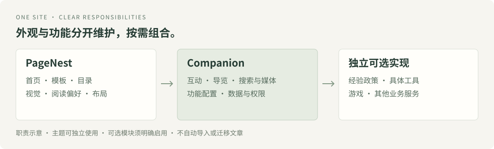

# PageNest Companion

为 WordPress 提供段落评论、章节导航、点赞与邮件通知，以及可选社交登录、内容导览和媒体展示。配合 PageNest · 栖页，让阅读外观与互动功能各有清楚的维护入口；其他主题也能使用独立评论抽屉。

Companion plugin for PageNest: reading interactions, social accounts, content guides and media presentation.

需要 **WordPress 6.0+、PHP 8.0+**。安装目录保持 `pagenest-compatibility`。

[安装与使用](docs/USAGE.md) · [更新记录](CHANGELOG.md) · [发行说明](docs/RELEASING.md)

## 开始使用

1. 从 仓库页面的 **Releases** 下载插件安装 ZIP，在 WordPress 后台 “插件 → 安装插件 → 上传插件” 安装并启用。
2. 打开 “设置 → PageNest Companion”，选择段落评论、章节导航和点赞。
3. 编辑一篇文章，在 “PageNest 阅读功能” 中明确启用段落评论，填写系列名称及章节顺序，然后保存。
4. 用两个不同账号检查评论和点赞；退出登录确认访客只能阅读公开内容。

关闭功能会保留既有记录。新文章默认不启用段落评论，插件不会批量扫描、注册或公开旧文章。

## 阅读与互动

- **段落评论**：选择正文段落后发布公开评论，需要登录并明确确认。读者可编辑或删除自己的内容；遇到并发修改会提示重新读取。兼容接入的私人笔记继续由作者本人读取，未知可见性保持私人。
- **章节导航**：同名系列按章节顺序关联上一篇与下一篇；只有有权阅读、未被密码锁定的文章才显示。旧 Markdown 章节链接可由管理员显式配置转换，正文原稿保持不变。
- **文章点赞**：登录后可给公开可读文章点赞，作者不能给自己点赞。重复请求和历史点赞不会重复计数；经验插件可以订阅事件，停用经验插件不影响点赞。
- **评论邮件**：审核通过的普通 WordPress 留言通知作者，回复通知原评论者，避免本人通知、重复投递和原生通知重复。默认使用站点现有邮件服务；可由服务器配置启用 Brevo API 传输，不提供历史通知补发。
- **编辑兼容**：保留逐篇编辑器选择及 Markdown 公式保护；配合支持的主题适配 Prism 和 MathJax。

## 浏览计数

浏览计数默认关闭；在设置页明确启用后，每次公开文章或页面加载计数一次，显示在 PageNest 文章底栏。可选所有人、访客或登录用户，以及已知机器人排除；`%VIEW_COUNT%` 模板只支持纯文本。读取或重复渲染不计数，计数不参与经验奖励。

仅支持无页面缓存的 PHP 渲染。`WP_CACHE=true` 时停止计数并提示管理员，已有计数保留；没有 AJAX、REST、排行榜、小工具或短代码。启用不扫描或迁移旧文章。其他主题可通过 `pagenest_article_actions` 显示，扩展读取接口见扩展指南。

## 可选站点服务

- **社交登录**：QQ、百度、微博、GitHub、Google 与微信网站应用，管理员逐家配置并明确启用。账号按应用身份关联，不按邮箱合并；支持首次注册资料、近期身份确认与验证恢复邮箱。
- **邮件与验证码**：可使用 Brevo API 邮件传输和 Turnstile 原生登录、注册、重置密码、普通评论验证；也可沿用已有邮件服务。
- **分享**：支持 QQ、微博、QQ 空间与本地微信二维码，资源不依赖远端分享脚本。

这些服务默认关闭，凭据由授权管理员或受限服务器配置管理；旧负责人仍运行时，新模块不会接管。

> [社交账号、供应商配置与恢复邮箱](docs/USAGE.md#社交账号与恢复邮箱) · [服务配置及限制](docs/EXTENDING.md)

## 可选内容展示

通过独立服务器配置启用资源目录、通用内容导览、阅读跳转、分类／标签导览和章节展示。编程学习路线可以作为配置实例，也可组织其他专题。保留原生正文、稳定锚点和阅读权限；无 JavaScript 时正文与链接仍可用。

> [内容模块配置与扩展接口](docs/EXTENDING.md)

## 可选媒体展示

迁移配置就绪后，可显示既有画廊和 PDF 短代码／区块，无需改写文章正文。画廊支持轮播、移动端单列和键盘灯箱；PDF 使用随包提供的独立查看器，并保留文件链接。此模块默认关闭，已有展示负责人优先；媒体上传、图片编辑与详情使用 WordPress 原生功能，文件夹可由 Companion 独立管理。

配置与迁移范围见[使用指南](docs/USAGE.md#可选媒体展示)。后台保留 WordPress 原生上传、附件详情和图片编辑；启用自有媒体文件夹后，支持目录卡片、层级管理、多目录分配，以及网格、列表和媒体选择器筛选，无需额外媒体组织插件。也可保留原组织插件，仅使用只读目录导航。

## 旧站升级

先备份文件与数据库，再停用原来拥有同一功能的插件或桥接代码，避免两个组件同时写入。服务器管理员通过 Web 根之外的显式配置接入旧存储、路由和别名；后台操作只保存新的中性设置，旧记录不需要重写。配置错误时功能停止并提示管理员。

插件保护既有私人记录；它不提供积分政策或数据库重算。**Reader Experience** 是可选的独立扩展。

MathJax 2.7.7 按主题特性从 cdnjs 加载，会产生第三方请求，库文件不随包发行。升级后应按实际编辑器和邮件服务验证保存、渲染与投递。

## 文档与开发

[使用指南](docs/USAGE.md) 介绍配置、权限、编辑器和升级；[扩展接口](docs/EXTENDING.md) 记录服务器配置 schema；[贡献指南](CONTRIBUTING.md) 说明格式、真实 WordPress/数据库/并发及浏览器测试；[发行指南](docs/RELEASING.md) 说明校验与安装包。

采用 **GPL-2.0-or-later**，详见 [LICENSE](LICENSE)。版权归 PageNest Contributors（2026）所有；外部插件与远端加载库保留各自许可证。

## Experimental optional tools host

Version 1.2.0 adds a default-off generic tools host. Browser tools, games and private
services are separate optional implementation plugins and are excluded from this ZIP.
See [tools API and configuration](docs/tools.md) for explicit enablement, profile contracts
and the old-owner guard.

## 页面测速开发模块

开发模块提供默认关闭的管理员公开代表页选择、手动队列与独立浏览器执行器，支持首次／再次访问成对测量、同条件历史对照和私有 JSON 导出。
执行器增加真实内核限额启动检查、请求与流量预算、活动取消和独立手动服务模板，以及领取任务前的真实 Chromium 沙箱预检。隔离环境已验证精确浏览器路径的 AppArmor userns 例外和完整 service 保护；模板未安装，拟部署 FPM 身份、容器映射及 WordPress 集成仍待后续授权验收。
结果属于受控环境的导航采样；每轮首次访问使用全新环境，再次访问仅复用本对的 HTTP 缓存。当前尚未合并验收或上线，须等待维护者明确通知。
配置、指标范围和运行边界见 [页面测速](docs/performance.md)。
