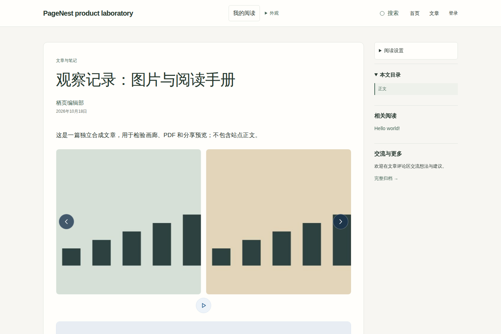
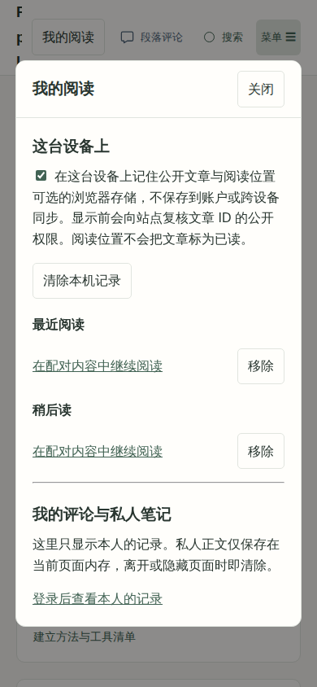
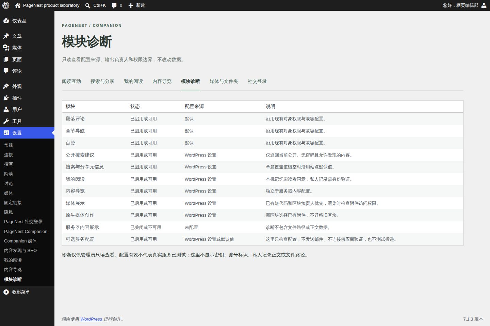

# 阅读、创作与管理的实际效果

以下截图来自独立合成 WordPress 站点，使用 **PageNest 1.3.0-rc.1 / Companion 1.6.0-rc.1 候选**。候选尚未正式发行，截图不代表生产部署。文中内容、图片与展示身份均为合成素材；手机截图是浏览器尺寸模拟。

## 阅读图片，让正文保持在中心

可选媒体模块把画廊和 PDF 放进正文阅读流程。画廊提供翻页和键盘灯箱，PDF 保留文件直达链接；访问时仍检查附件和文章权限。原生创作入口属于本轮候选，需明确启用，作者从已有附件中选取图片或文件，不自动转换旧区块。

[媒体展示、文件夹与原生创作设置](USAGE.md#可选媒体展示)

## 在这台设备上，继续刚才的阅读

“我的阅读” 把本机公开阅读位置、稍后读入口与本人的评论／私人笔记放在一起。需要读者单独同意才保存本机公开阅读记录；不保存到账户或跨设备同步。私人正文只在通过权限校验后的当前页面内存中使用。

[阅读中心的启用方式与数据边界](USAGE.md#我的阅读与独立内容导览)

## 管理员先看清状态，再决定启用什么

只读模块诊断集中显示配置来源、输出归属和权限边界。配置有效不等于供应商已验证，诊断不会发送邮件或连接社交供应商，也不会展示密钥或私人正文。

新导览编辑器组织已有公开内容的分组与链接，支持键盘排序和来源预览；它不会覆盖服务器内容配置或改写文章。具体入口见[使用指南](USAGE.md#我的阅读与独立内容导览)。

## 这组展示的范围

- 这些界面展示主题与插件的组合效果；其他主题可使用独立评论抽屉，完整外观由各主题决定。
- 社交登录、邮件、验证码与管理员页面测速需要各自配置。截图不构成供应商真实登录、邮件投递或测速部署验收。
- 展示图只用于仓库文档，不进入插件安装 ZIP；安装不会导入这些内容。

返回[文档导航](index.md)或[项目首页](../README.md)。
